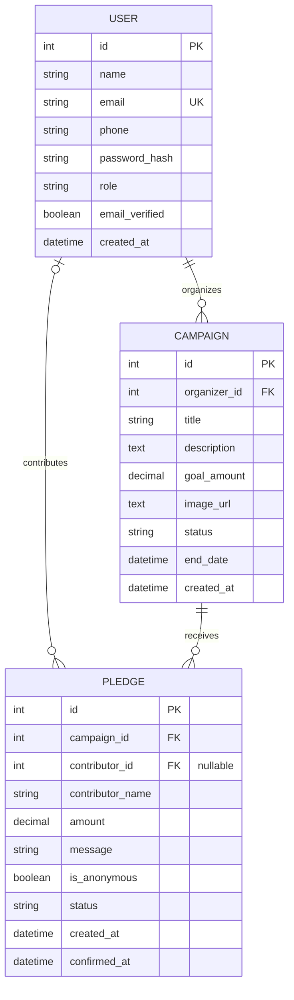

# Harambee Hub Database Design

This document describes the database structure implemented in the backend models.

## Entity Relationship Diagram

## Database Tables

### 1. User

- id: Primary key
- name: User's name
- email: Unique email address
- phone: Phone number
- password_hash: Hashed password
- role: organizer or contributor
- email_verified: Email verification status
- created_at: Account creation date

### 2. Campaign

- id: Primary key
- organizer_id: Foreign key referencing user.id
- title: Campaign title
- description: Campaign description
- goal_amount: Fundraising target
- image_url: Campaign image
- status: Campaign status, default active
- end_date: Campaign end date
- created_at: Campaign creation date

### 3. Pledge

- id: Primary key
- campaign_id: Foreign key referencing campaign.id
- contributor_id: Nullable foreign key referencing user.id
- contributor_name: Contributor's name
- amount: Pledged amount
- message: Optional pledge message
- is_anonymous: Whether the pledge is anonymous
- status: pending, confirmed, or cancelled
- created_at: Pledge creation date
- confirmed_at: Date the pledge was confirmed

## Relationships

1. One user can organize many campaigns.
2. One campaign can receive many pledges.
3. One user can make many pledges.
4. A pledge can have a null contributor_id.

## Important Notes

- The application uses two roles: organizer and contributor.
- Campaign ownership is tracked using organizer_id.
- Campaigns use end_date, not deadline.
- Campaigns do not currently have a category column.
- Pledges use pending, confirmed, and cancelled statuses.
- Pledge amounts and campaign goals use Numeric(12, 2).
- The current pledge model uses confirmed_at, not paid_at.
