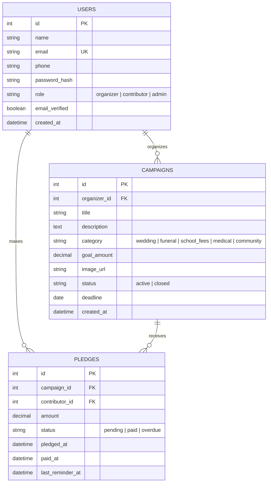

# Database design

Proposal for the team to confirm on Day 1. Update this file whenever a model changes.

## Entity relationship diagram

GitHub renders this diagram automatically.



## DBML (paste into dbdiagram.io for a picture)

```
Table users {
  id integer [pk, increment]
  name varchar(100) [not null]
  email varchar(255) [not null, unique]
  phone varchar(20)
  password_hash varchar(255) [not null]
  role varchar(20) [not null, note: 'organizer | contributor | admin']
  email_verified boolean [not null, default: false]
  created_at timestamp [not null]
}

Table campaigns {
  id integer [pk, increment]
  organizer_id integer [not null, ref: > users.id]
  title varchar(150) [not null]
  description text
  category varchar(30) [not null]
  goal_amount decimal(12,2) [not null]
  image_url varchar(500)
  status varchar(20) [not null, default: 'active']
  deadline date
  created_at timestamp [not null]
}

Table pledges {
  id integer [pk, increment]
  campaign_id integer [not null, ref: > campaigns.id]
  contributor_id integer [not null, ref: > users.id]
  amount decimal(12,2) [not null]
  status varchar(20) [not null, default: 'pending']
  pledged_at timestamp [not null]
  paid_at timestamp
  last_reminder_at timestamp
}
```

## Why this satisfies 2NF

- Every table has a single-column primary key (`id`), so no non-key column can depend on only part of a key.
- Every non-key column describes only its own row. The organizer's name is not copied into `campaigns`, it is reached through `organizer_id`. A campaign's title is not copied into `pledges`, it is reached through `campaign_id`.
- Relationships: one user organizes many campaigns, one campaign receives many pledges, and one user makes many pledges.
- Campaign progress (total pledged, total collected) is calculated from `pledges`, not stored, so it can never be out of date.

## Decisions for the team

- **Paid vs pledged:** this design marks a pledge as paid with `status` and `paid_at`. If a contributor must be able to pay in several instalments, add a `payments` table (`id`, `pledge_id` FK, `amount`, `paid_at`) and calculate the pledge's status from it.
- **One pledge per person per campaign?** If yes, add a unique constraint on (`campaign_id`, `contributor_id`).
- **Email verification:** the verification token is a signed, time-limited string and is not stored. Only the `email_verified` flag is. M6 adds it to the `User` model with a migration (default `false`), and M2's registration flow sets it to `true` when the link in the email is used.
- **Money:** use `Numeric(12, 2)`, never floats.
- **Admins** are created in `seed.py` only, never through registration.
